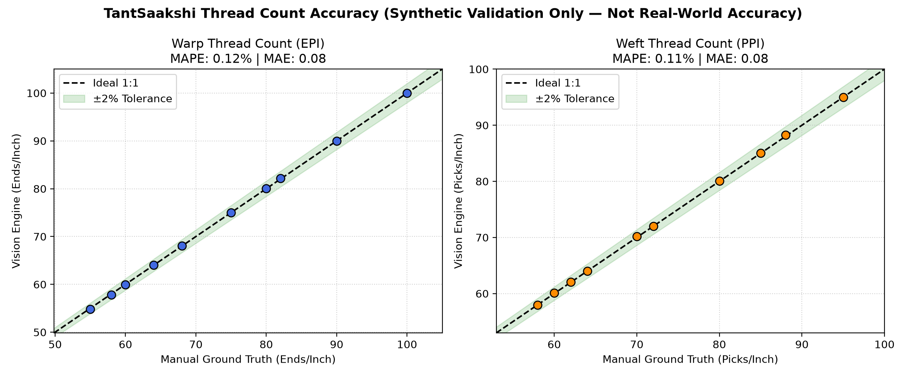

# TantSaakshi Thread Density Evaluation Report

> [!WARNING]
> **synthetic validation only — not real-world accuracy**

- **Date:** 2026-11-13
- **Evaluated Sarees:** 10
- **Warp MAPE:** `0.12%` (MAE: `0.08` threads/inch, Max: `0.27%`)
- **Weft MAPE:** `0.11%` (MAE: `0.08` threads/inch, Max: `0.29%`)

## Per-Saree Breakdown

| Saree ID | GT Warp | Engine Warp | Warp Err (%) | GT Weft | Engine Weft | Weft Err (%) | Native px/mm |
| :--- | :---: | :---: | :---: | :---: | :---: | :---: | :---: |
| `saree_01` | 60.0 | 59.9 | 0.12% | 60.0 | 60.1 | 0.21% | 32.0 |
| `saree_02` | 68.0 | 68.1 | 0.08% | 72.0 | 72.0 | 0.00% | 29.9 |
| `saree_03` | 80.0 | 80.0 | 0.05% | 80.0 | 80.1 | 0.11% | 35.0 |
| `saree_04` | 55.0 | 54.9 | 0.26% | 58.0 | 58.0 | 0.02% | 27.9 |
| `saree_05` | 90.0 | 90.0 | 0.00% | 85.0 | 85.1 | 0.07% | 36.0 |
| `saree_06` | 64.0 | 64.1 | 0.11% | 64.0 | 64.0 | 0.01% | 29.9 |
| `saree_07` | 75.0 | 75.0 | 0.03% | 70.0 | 70.2 | 0.26% | 33.9 |
| `saree_08` | 100.0 | 100.0 | 0.05% | 95.0 | 95.0 | 0.00% | 38.0 |
| `saree_09` | 58.0 | 57.8 | 0.27% | 62.0 | 62.1 | 0.11% | 25.9 |
| `saree_10` | 82.0 | 82.2 | 0.23% | 88.0 | 88.3 | 0.29% | 32.9 |

## Scatter Plot

