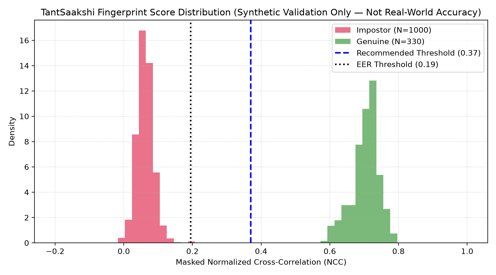
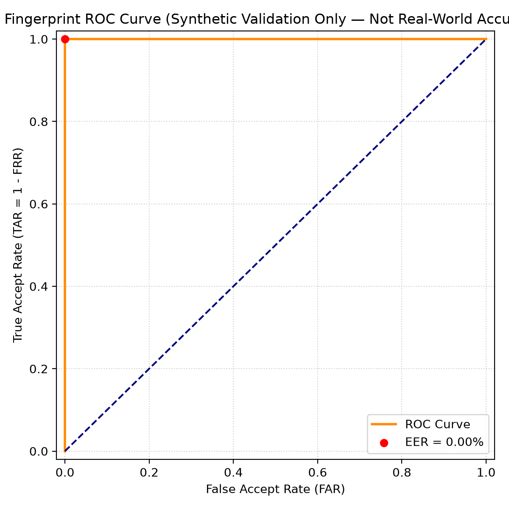
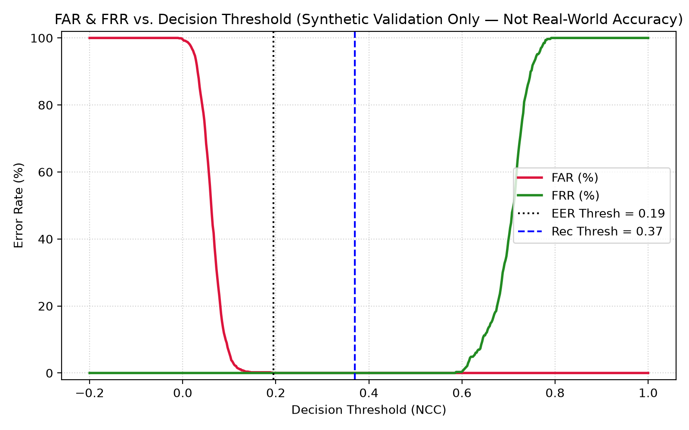
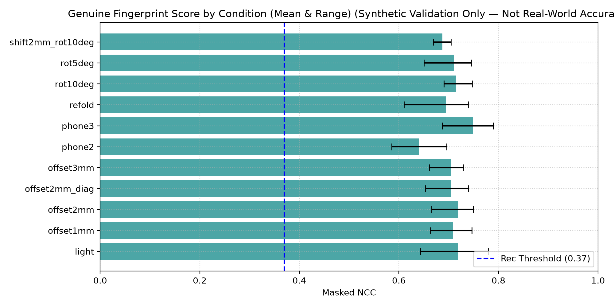

# TantSaakshi Fingerprint Matching & Calibration Report

> [!WARNING]
> **synthetic validation only — not real-world accuracy**

- **Evaluation Date:** 2026-11-13
- **Total Genuine Pairs:** 330
- **Total Impostor Pairs:** 1000
- **Genuine NCC Range:** `[0.5855, 0.7897]` (Mean: `0.7036`)
- **Impostor NCC Range:** `[-0.0079, 0.1945]` (Mean: `0.0621`)
- **Separation Margin (Genuine Min − Impostor Max):** `0.3911`
- **Equal Error Rate (EER):** `0.00%` (at threshold `0.195`)

## Recommended Decision Threshold

> [!IMPORTANT]
> **Recommended NCC Threshold:** `match_threshold_residual: 0.37`
> - **Margin to Impostor Max:** `+0.1755` above `0.1945` (Zero False Accepts: FAR = `0.00%`)
> - **Margin to Genuine Min:** `+0.2155` below `0.5855` (Zero False Rejects: FRR = `0.00%`)
> - **NOTE:** Per protocol, this recommended threshold is reported here for Gate A calibration but kept `null` in `config.yaml` until real field saree photos are evaluated.

## Condition Breakdown

| Condition | N Pairs | Mean NCC | Min NCC | Max NCC | FRR @ Rec Thresh |
| :--- | :---: | :---: | :---: | :---: | :---: |
| `light` | 50 | 0.7184 | 0.6432 | 0.7795 | 0.0% |
| `offset1mm` | 35 | 0.7089 | 0.6625 | 0.7466 | 0.0% |
| `offset2mm` | 30 | 0.7194 | 0.6660 | 0.7497 | 0.0% |
| `offset2mm_diag` | 25 | 0.7050 | 0.6536 | 0.7401 | 0.0% |
| `offset3mm` | 20 | 0.7044 | 0.6610 | 0.7299 | 0.0% |
| `phone2` | 45 | 0.6398 | 0.5855 | 0.6962 | 0.0% |
| `phone3` | 40 | 0.7481 | 0.6875 | 0.7897 | 0.0% |
| `refold` | 55 | 0.6946 | 0.6106 | 0.7389 | 0.0% |
| `rot10deg` | 10 | 0.7148 | 0.6904 | 0.7471 | 0.0% |
| `rot5deg` | 15 | 0.7105 | 0.6505 | 0.7454 | 0.0% |
| `shift2mm_rot10deg` | 5 | 0.6872 | 0.6689 | 0.7048 | 0.0% |

## Evaluation Plots

### Score Distribution Histogram

### ROC Curve

### FAR & FRR vs. Threshold

### Breakdown by Condition

