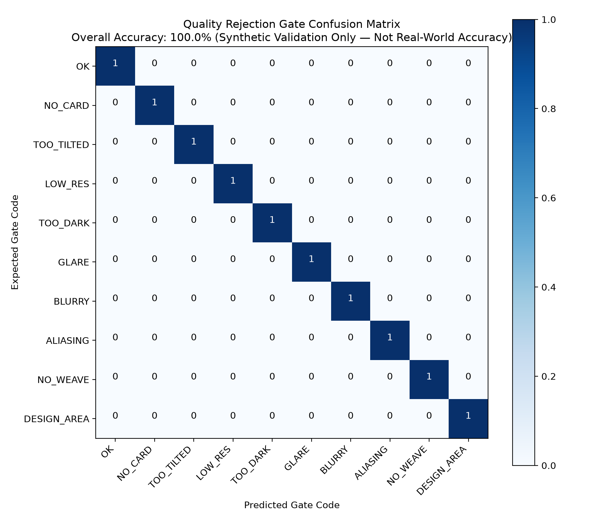

# TantSaakshi Image Quality Rejection Gate Evaluation

> [!WARNING]
> **synthetic validation only — not real-world accuracy**

- **Evaluation Date:** 2026-11-13
- **Total Test Cases:** 10
- **Overall Gate Accuracy:** `100.0%` (10/10)

## Test Case Breakdown

| Test Case | Expected Code | Predicted Code | Status | Reason / Guidance |
| :--- | :---: | :---: | :---: | :--- |
| `case_01_OK.png` | `OK` | `OK` | ✅ PASS |  |
| `case_02_NO_CARD.png` | `NO_CARD` | `NO_CARD` | ✅ PASS | Show the whole card — missing markers: [0, 1, 2, 3] |
| `case_03_TOO_TILTED.png` | `TOO_TILTED` | `TOO_TILTED` | ✅ PASS | Hold the phone flat |
| `case_04_LOW_RES.png` | `LOW_RES` | `LOW_RES` | ✅ PASS | Move closer |
| `case_05_TOO_DARK.png` | `TOO_DARK` | `TOO_DARK` | ✅ PASS | Turn on the light |
| `case_06_GLARE.png` | `GLARE` | `GLARE` | ✅ PASS | Glare — tilt the phone a little |
| `case_07_BLURRY.png` | `BLURRY` | `BLURRY` | ✅ PASS | Too blurry — hold still |
| `case_08_ALIASING.png` | `ALIASING` | `ALIASING` | ✅ PASS | Move closer — threads too small to count reliably |
| `case_09_NO_WEAVE.png` | `NO_WEAVE` | `NO_WEAVE` | ✅ PASS | Can't see the threads — move closer / refocus |
| `case_10_DESIGN_AREA.png` | `DESIGN_AREA` | `DESIGN_AREA` | ✅ PASS | Move the card to a plain area |

## Confusion Matrix

