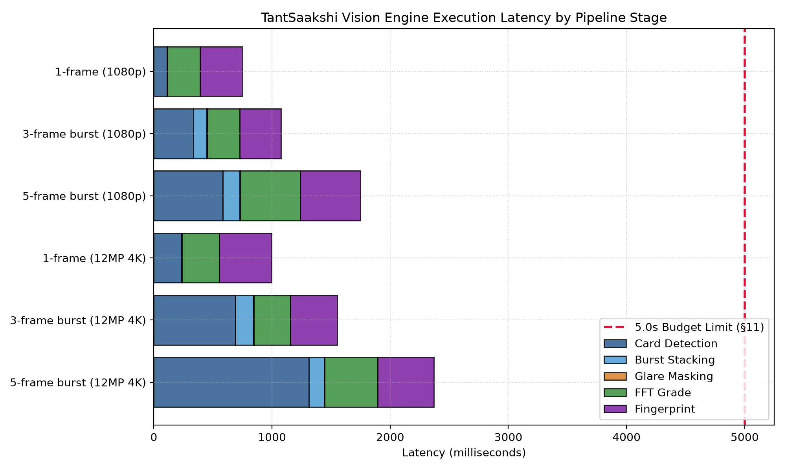

# TantSaakshi Vision Engine Timing Benchmark Report

- **Benchmark Date:** 2026-11-13
- **Repetitions per test:** 2

## Latency Summary Table

| Configuration | Frames | Resolution | Median Total | P90 Total | Match Time | Budget Check (<5s) |
| :--- | :---: | :---: | :---: | :---: | :---: | :---: |
| `1-frame (1080p)` | 1 | 1920x1080 | `856.5 ms` | `858.7 ms` | `28.5 ms` | ✅ PASS |
| `3-frame burst (1080p)` | 3 | 1920x1080 | `1317.1 ms` | `1344.0 ms` | `26.2 ms` | ✅ PASS |
| `5-frame burst (1080p)` | 5 | 1920x1080 | `2196.0 ms` | `2319.3 ms` | `24.5 ms` | ✅ PASS |
| `1-frame (12MP 4K)` | 1 | 4000x3000 | `1173.0 ms` | `1209.6 ms` | `21.8 ms` | ✅ PASS |
| `3-frame burst (12MP 4K)` | 3 | 4000x3000 | `2011.7 ms` | `2080.5 ms` | `28.1 ms` | ✅ PASS |
| `5-frame burst (12MP 4K)` | 5 | 4000x3000 | `3099.4 ms` | `3145.9 ms` | `25.3 ms` | ✅ PASS |

## Per-Stage Breakdown (Milliseconds, Mean)

| Configuration | Card Detection | Burst Stacking | Glare Mask | FFT Grade | Fingerprint |
| :--- | :---: | :---: | :---: | :---: | :---: |
| `1-frame (1080p)` | 111.7 | 0.5 | 3.3 | 276.3 | 354.8 |
| `3-frame burst (1080p)` | 335.5 | 113.5 | 3.6 | 273.5 | 350.5 |
| `5-frame burst (1080p)` | 582.5 | 144.9 | 3.6 | 506.5 | 510.2 |
| `1-frame (12MP 4K)` | 233.9 | 1.1 | 4.6 | 313.8 | 444.0 |
| `3-frame burst (12MP 4K)` | 691.1 | 152.4 | 3.2 | 310.4 | 394.7 |
| `5-frame burst (12MP 4K)` | 1313.6 | 126.8 | 5.2 | 449.5 | 474.8 |

## Breakdown Visualization

